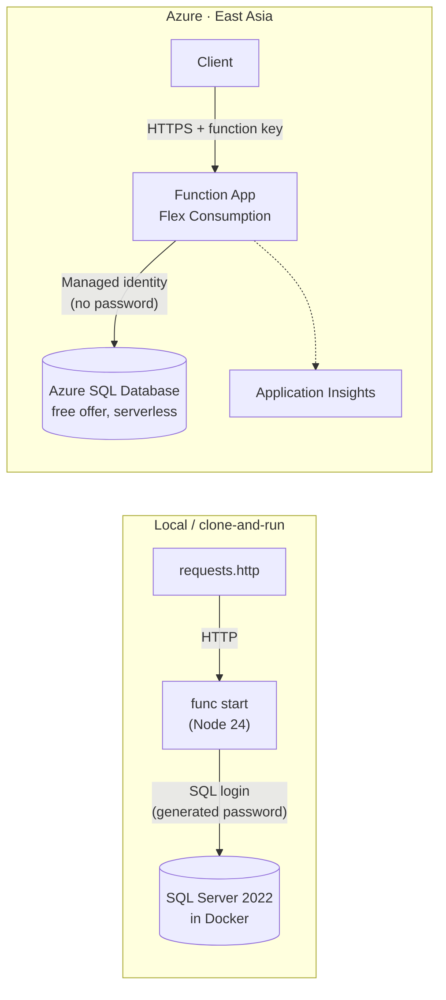

# Employee Compensation Service

[](https://github.com/SujalPati1/employee-compensation-service/actions/workflows/ci.yml)

A backend for an HR team: HTTP-triggered **Azure Functions** (TypeScript) backed by **Azure SQL Database**.
It manages employee records (Part A) and answers six compensation questions where a missing bonus
(`NULL`) must be handled correctly (Part B). Every read and write goes through the Functions layer.

- **Live API:** `https://func-compensation-c4p4kq.azurewebsites.net/api` (health check: [`/api/health`](https://func-compensation-c4p4kq.azurewebsites.net/api/health); other endpoints need a function key, available on request)
- **Design notes, assumptions and trade-offs:** [`docs/DESIGN.md`](docs/DESIGN.md)

## Contents

- [Architecture](#architecture)
- [Run it locally](#run-it-locally)
- [API](#api)
- [Tests](#tests)
- [Deploy to Azure](#deploy-to-azure)
- [Before a demo](#before-a-demo)
- [Project structure](#project-structure)

## Architecture



- **Same code and SQL scripts in both environments.** Only configuration differs (`SQL_AUTH=sql` locally, `SQL_AUTH=entra` in Azure).
- **No passwords in Azure.** The Function App signs in to SQL with its managed identity; storage account keys are disabled.
- **All money arithmetic runs in SQL** on exact `DECIMAL` values. The TypeScript layer validates input, passes values through and maps errors to HTTP status codes.
- Request flow: handler (`src/functions`) → zod validation → repository with parameterized SQL (`src/repositories`) → one shared connection pool with retry (`src/db/pool.ts`).

## Run it locally

### Prerequisites

| Tool | Version | Install (Windows) | Install (macOS) |
|------|---------|-------------------|-----------------|
| Node.js | 22 or later (24 recommended) | `winget install OpenJS.NodeJS.LTS` | `brew install node` |
| Azure Functions Core Tools | 4.x | `winget install Microsoft.Azure.FunctionsCoreTools` | `brew tap azure/functions && brew install azure-functions-core-tools@4` |
| Docker Desktop | any recent | `winget install Docker.DockerDesktop` (needs WSL2: `wsl --install`) | `brew install --cask docker` |
| Git | any | `winget install Git.Git` | `brew install git` |

Docker Desktop must be running. SQL Server needs about 2 GB of memory.

### Start

```bash
git clone https://github.com/SujalPati1/employee-compensation-service.git
cd employee-compensation-service
npm install
npm run setup      # generates a local database password into .env and local.settings.json (both gitignored)
npm run db:up      # starts SQL Server 2022 in Docker on localhost:14333
npm run db:setup   # creates the database, tables, view and demo data (safe to re-run; resets the data)
npm start          # API on http://localhost:7071/api
```

Check it: open <http://localhost:7071/api/health>, then try the requests in [`requests.http`](requests.http)
(VS Code with the REST Client extension), or run `npm run smoke` to call every endpoint once.
No function key is needed locally.

**Using Postman?** Import [`postman/employee-compensation.postman_collection.json`](postman/employee-compensation.postman_collection.json).
It holds every request with tests, and runs in order in the Collection Runner (it creates one employee, changes
it and deletes it). For Azure, set the collection variables `baseUrl` to the Azure URL and `functionKey` to your key
(Current value only, so it stays on your machine). From the command line: `postman collection run postman/employee-compensation.postman_collection.json`.

Stop the database with `npm run db:down` (data is kept). `docker compose down -v` deletes it.

### Troubleshooting

| Symptom | Fix |
|---------|-----|
| `Login failed for user 'sa'` | The database volume was created with an older password (SQL Server only sets it on first start). Reset it: `docker compose down -v`, then `npm run db:up` and `npm run db:setup`. |
| `Is the database running?` | Start Docker Desktop, then `npm run db:up`. |
| Port `14333` or `7071` already in use | Change `SQL_PORT` in `.env` and `local.settings.json`, or stop the other process. |
| `func: command not found` | Install Azure Functions Core Tools v4 and open a new terminal. |
| First request to Azure takes about a minute | The serverless database was paused; see [Before a demo](#before-a-demo). |

### Commands

| Command | What it does |
|---------|--------------|
| `npm run setup` | Generates local secrets. Keeps an existing password; `-- --force` makes a new one |
| `npm run db:up` / `db:down` | Starts / stops the local SQL Server container |
| `npm run db:setup` | Runs `sql/*.sql` in order (schema, view, demo data) |
| `npm start` | Builds and runs the Functions host locally |
| `npm test` | Unit and integration tests (needs `db:up`) |
| `npm run test:unit` | Unit tests only, no database needed |
| `npm run smoke [-- <baseUrl>]` | Calls every endpoint once and checks status codes |
| `npm run deploy -- <function-app>` | Publishes to Azure (see below) |

## API

Base path `/api`. JSON in camelCase. Money values are numbers rounded to 2 decimal places by SQL.

### Part A: employees

| Method and route | Success | Errors |
|------------------|---------|--------|
| `POST /employees` | `201` + `Location` + employee | `400` invalid body, `422` unknown department |
| `GET /employees` | `200` `{ items, count }` | |
| `GET /employees?departmentId=2` | `200` `{ items, count }` | `400` invalid filter |
| `GET /employees/{id}` | `200` employee | `400` invalid id, `404` |
| `PATCH /employees/{id}` | `200` employee | `400`, `404`, `422` |
| `DELETE /employees/{id}` | `204` | `400`, `404` |

`POST` needs `firstName`, `lastName` and `salary`; `bonus`, `departmentId` and `hireDate` (`YYYY-MM-DD`) are optional.
`PATCH` is a merge patch: fields you leave out stay unchanged, and `null` clears a field (`{"bonus": null}` removes a bonus).

An employee response carries the stored bonus and, separately, the optional 5% default:

```json
{
  "employeeId": 2, "firstName": "Meera", "lastName": "Iyer",
  "departmentId": 1, "departmentName": "Engineering",
  "salary": 150000, "bonus": null, "hireDate": "2019-07-15",
  "effectiveBonus": 7500, "isDefaultBonus": true,
  "totalCompensation": 150000, "effectiveTotalCompensation": 157500
}
```

### Part B: reports

| Route | Answers |
|-------|---------|
| `GET /reports/total-bonus` | Total bonus paid; no bonus counts as 0 |
| `GET /reports/employees-without-bonus` | Employees who have never received a bonus (`NULL`) |
| `GET /reports/bonus-percentage` | Bonus as a % of salary, 2 dp, for employees who have a bonus |
| `GET /reports/departments-bonus-over-avg-salary` | Departments whose total bonus exceeds their average salary |
| `GET /reports/bonus-ranking` | Everyone ranked by bonus; no bonus ranked last |
| `GET /reports/top-earner` | Highest-salary employee(s), and whether each also has the highest salary + bonus |

### Other

| Route | Notes |
|-------|-------|
| `GET /departments` | Read-only list of departments |
| `GET /health` | No key needed. Checks the database; also wakes a paused database |

### Errors

Every error uses one shape. `correlationId` matches the request in Application Insights.

```json
{
  "error": "UnknownDepartment",
  "message": "The department does not exist.",
  "details": [{ "field": "departmentId", "issue": "no department has this ID" }],
  "correlationId": "4f2a9c1e-…"
}
```

`400` malformed request · `401` missing function key (Azure only) · `404` not found · `422` breaks a business rule ·
`503` database temporarily unavailable, with `Retry-After` · `500` unexpected (no internal details returned).

## Tests

```bash
npm run db:up   # integration tests use a separate CompensationTest database
npm test        # 120 tests: 72 unit + 48 integration
```

- **Integration tests run the real SQL** against SQL Server in Docker. The report logic lives in SQL, so mocking the database would test nothing.
- The report tests use a fixed fixture ([`tests/fixtures/fixture.sql`](tests/fixtures/fixture.sql)) whose expected results were **worked out by hand before the queries were written**: [`tests/fixtures/EXPECTED.md`](tests/fixtures/EXPECTED.md).
- Tests refuse to run against any database whose name does not contain "Test", so demo data is never touched.
- [GitHub Actions](.github/workflows/ci.yml) runs typecheck, lint, build, the SQL scripts (twice, to prove they are re-runnable) and all tests against a SQL Server service container on every push.

## Deploy to Azure

The infrastructure is defined in [`infra/main.bicep`](infra/main.bicep): Function App (Flex Consumption), storage,
Azure SQL (free offer) and Application Insights. Requires the [Azure CLI](https://learn.microsoft.com/cli/azure/install-azure-cli).

```bash
az login
az group create -n rg-compensation-eastasia -l eastasia

# 1. Infrastructure (you become the SQL server's Microsoft Entra admin; no SQL password exists)
az deployment group create -g rg-compensation-eastasia -f infra/main.bicep \
  -p sqlAdminLogin=<your-upn> sqlAdminObjectId=$(az ad signed-in-user show --query id -o tsv)

# 2. Allow your IP on the SQL server (db:setup prints this command with your IP if it is blocked)
az sql server firewall-rule create -g rg-compensation-eastasia -s <sql-server> -n my-ip \
  --start-ip-address <your-ip> --end-ip-address <your-ip>

# 3. Schema, view and demo data, signing in as you; then give the app read/write access to data only
npm run db:setup -- --azure <sql-server> --grant-app <function-app>

# 4. Publish the code
npm run deploy -- <function-app>

# 5. Check every endpoint
AZURE_FUNCTION_KEY=$(az functionapp keys list -g rg-compensation-eastasia -n <function-app> --query functionKeys.default -o tsv) \
  npm run smoke -- https://<function-app>.azurewebsites.net/api
```

Resource names come from the deployment outputs. The region must support both Flex Consumption and the
Azure SQL free offer (East Asia does; Indonesia Central, for example, has no free offer).
`npm run deploy` builds a clean package with only the compiled code and production dependencies, so local
secrets cannot be uploaded.

## Before a demo

1. Call `/api/health` about a minute beforehand. After an hour idle the serverless database pauses; the
   first request then waits for it to resume (measured: about 55 seconds, handled by the retry logic).
2. Run `npm run smoke -- <baseUrl>` to confirm every endpoint.
3. Optional: reset the demo data with `npm run db:setup` (local) or `npm run db:setup -- --azure <sql-server>`.
4. Close SQL tools connected to Azure afterwards. An open connection keeps the database awake and uses the free monthly allowance.

## Project structure

```
src/
  functions/      HTTP handlers: employees, departments, reports, health
  repositories/   all SQL (parameterized), one file per area
  db/             connection settings, shared pool, retry and transient-error rules
  http/           error types, error-to-status mapping, response helpers
  validation/     zod request schemas
  logging/        logger that only accepts non-personal fields
sql/              001_schema.sql, 002_views.sql, 003_seed.sql
scripts/          setup, db-setup, deploy, smoke
tests/            unit/, integration/, fixtures/
infra/            main.bicep
docs/DESIGN.md    assumptions, decisions, alternatives, limitations
requests.http     example requests (local and Azure)
```
